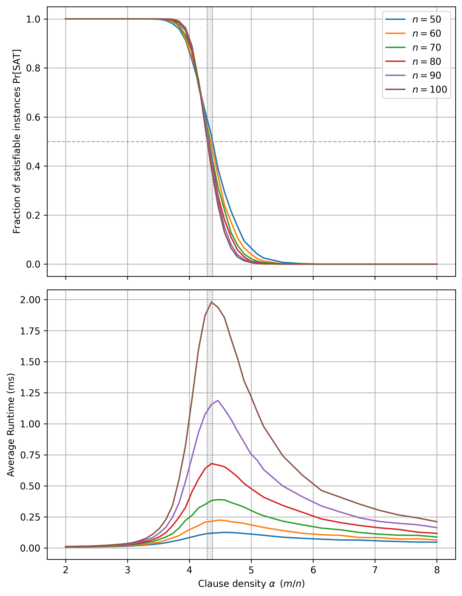
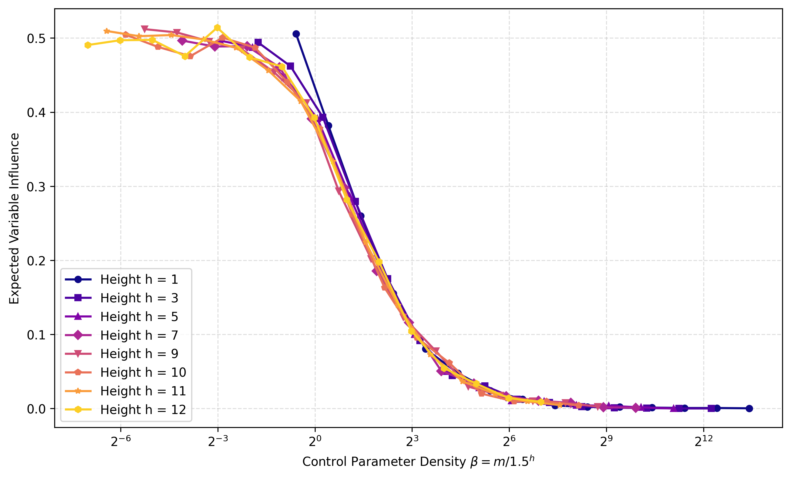
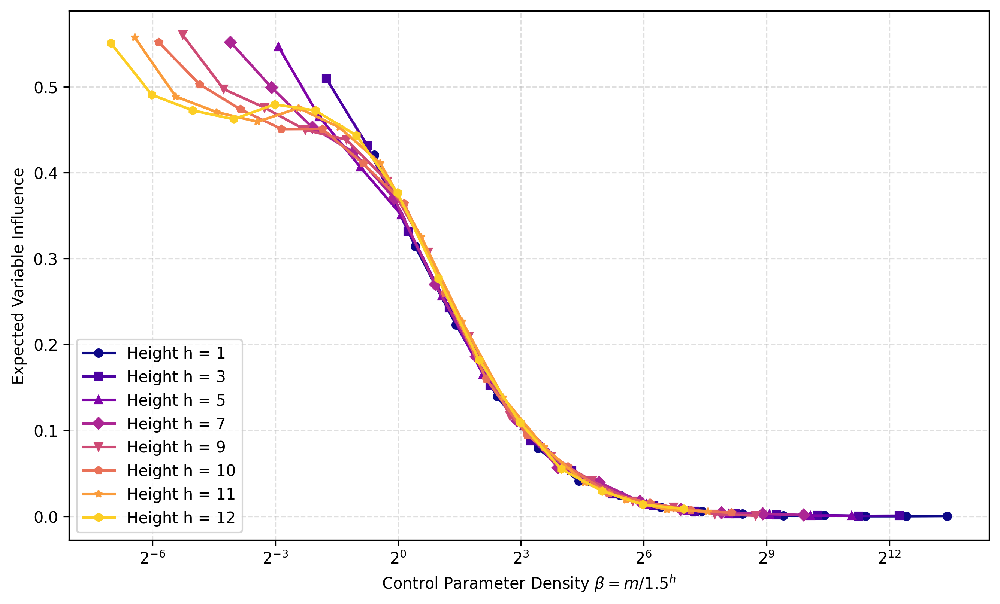
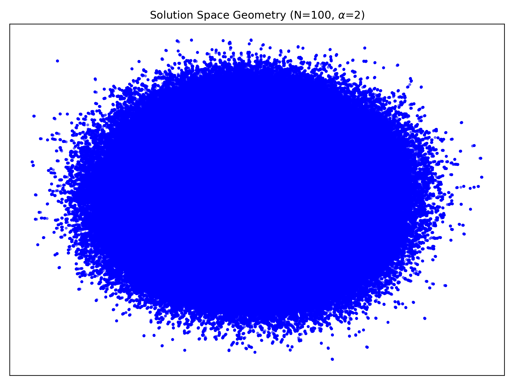
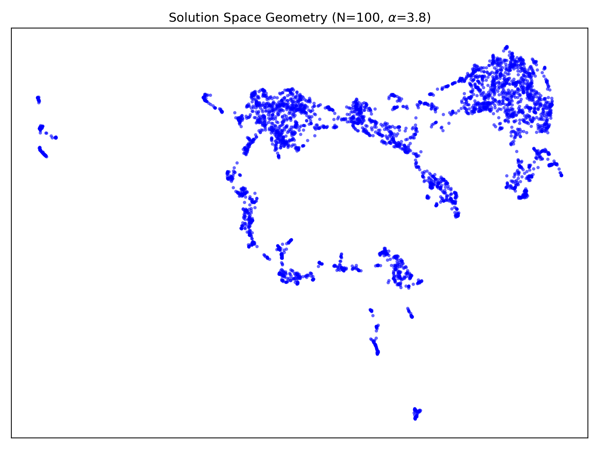

# From Local to Global Constraints: Phase Transitions in Random CSPs

Code for the BSc thesis *"From Local to Global Constraints: An Empirical Study of Phase Transitions in CSPs"* (Radboud University Nijmegen, 2026). [Read the thesis (PDF)](docs/thesis.pdf).

Random constraint satisfaction problems are known to undergo **phase transitions**: as a control parameter is varied smoothly, a global property of typical instances changes abruptly, and this change often coincides with a peak in computational hardness. Most of what is known concerns *local* ensembles such as random k-SAT, where every constraint involves a small, fixed number of variables.

This repository (and thesis) studies whether the same phenomena, and the same finite-size scaling methodology, is also present in *global* ensembles. It compares:

- **Random k-SAT** (local ensemble): the sharp satisfiability threshold, the runtime peak of a CDCL solver, and the clustering of the solution space.
- **Random If-Then-Else (ITE) trees** (global ensemble): a novel ensemble whose single constraint involves the whole variable pool. It has no satisfiability threshold, but it shows a **continuous first-order phase transition in individual variable influence**. Its finite-size scaling collapses onto a single curve for $\beta = m / 1.5^h$.

## Key results

<table>
<tr>
<td width="50%"></td>
<td width="50%"></td>
<td width="50%"></td>
</tr>
<tr>
<td><b>Random 3-SAT.</b> Pr[SAT] drops sharply around α ≈ 4.26 as n grows (top), and the solver runtime peaks inside the same window (bottom).</td>
<td><b>Random ITE trees.</b> Expected influence of a single variable. Rescaling the pool size by 1.5ʰ collapses all tree heights h onto one curve.</td>
</tr>
<tr>
<td></td>
<td></td>
</tr>
<tr>
<td colspan="2"><b>Solution-space geometry of random 3-SAT</b> (n = 100, UMAP projection of sampled solutions). At α = 2 the solutions form one giant connected component (left). At α = 3.8, past the clustering threshold, the space has shattered into isolated clusters (right).</td>
</tr>
</table>

## Background

**Random k-SAT** F<sub>k</sub>(n, m): a CNF formula over n variables with m = αn clauses. Each clause contains k distinct variables chosen uniformly at random, and each literal is negated with probability 1/2. As the clause density α grows, the probability of satisfiability drops from 1 to 0 around a threshold α<sub>k</sub> (α<sub>2</sub> = 1, α<sub>3</sub> ≈ 4.26). The drop gets sharper as n → ∞.

**Random ITE trees** T(h, β, Σ): a regular ternary tree of height h. Every internal node is the logic gate:

```
ITE(c, t, e) = (c ∧ t) ∨ (¬c ∧ e)        "if c then t else e"
```

The 3ʰ leaves are labelled uniformly and independently from an alphabet Σ, which contains the m pool variables and the constants 0 and 1, and optionally the negated variables. The control parameter β fixes how the pool size m scales with the height. The tree computes a single boolean function of all m variables, so its arity grows with the system size: it is a *globally constrained* CSP. Its **variable influence** is the probability that flipping one variable changes the value of the root. It plays the role of the order parameter.

Chapters 2 and 5 of the [thesis](docs/thesis.pdf) give the formal definitions.

## Installation

Requires Python 3.10 or newer (developed with 3.13).

```bash
git clone https://github.com/TreelonMusk/SAT-phase-transition.git
cd SAT-phase-transition
python -m venv .venv
source .venv/bin/activate        # Windows: .venv\Scripts\activate
pip install -r requirements.txt
```

## Quick start

Every experiment is a script in `src/` and has a matching plot script in `plots/`. Every option has a default, run any script with `--help` to see them all. Example commands for each of the five experiments (and plottings) are shown below:

```bash
# Random 3-SAT satisfiability threshold
python src/ksat_threshold.py --k 3 --n 30 40 50 --runs-low 200 --runs-high 1000 --seed 1
python plots/plot_ksat_threshold.py results/csv/3sat_n30-50_runs200-1000.csv

# Solution-space geometry of one random 3-SAT formula
python src/ksat_solution_space.py --n 50 --alpha 3 --clusters 100 --local-steps 100 --seed 1
python plots/plot_ksat_solution_space.py results/npy/solution_space_3sat_n50_a3.npy

# ITE tree satisfiability
python src/ite_satisfiability.py --heights 1 2 3 --beta-points 100 --runs 200 --seed 1
python plots/plot_ite_satisfiability.py results/csv/ite_sat_h1-3_height_runs200_noneg.csv

# Contingency of a random ITE tree
python src/ite_contingency.py --m 1 --heights 0 1 2 3 4 5 6 --runs 1000 --negations --seed 1
python plots/plot_ite_contingency.py results/csv/ite_contingency_m1_runs1000_neg.csv

# Individual variable (expected) influence for a random ITE tree
python src/ite_influence.py --heights 3 5 7 --runs 500 --negations --seed 1
python plots/plot_ite_influence.py results/csv/ite_influence_h3-5-7_runs500_neg.csv --scale-base 1.5
```

All scripts share these options:

| Option | Meaning |
|---|---|
| `--runs` | random instances sampled per parameter point |
| `--batch-size` | instances per task sent to a worker process |
| `--workers` | number of processes (default: all CPU cores) |
| `--seed` | base random seed; runs with the same seed give identical results |
| `--out` | output path (default: an auto-generated name in `results/`) |

## Outputs

- `results/csv/*.csv`: measurements, one row per parameter point.
- `results/csv/*.json`: written next to every CSV. It records the exact command, all arguments and a timestamp, so every data file can be easily reproduced.
- `results/npy/*.npy`: sampled solutions (a 0/1 matrix) from the solution-space experiment.
- `results/plots/*.png`: figures plotted from the CSV/.npy data.

(`results/` is not tracked by git, since large runs can produce several GB of data, especially the solution-space samples)

## Reproducing the thesis figures

The commands below use the parameters stated in the thesis. Long running times are expected for the full sample sizes of these runs.

| Figure | Experiment | Plot |
|---|---|---|
| 3.2, 3.3 | (analytical, no data) | `plot_moment_method.py lambda-s` / `lambda-n` |
| 4.1, 4.2 | `ksat_threshold.py --k 3` (defaults: n = 50…100, 1000/10 000 runs) | `plot_ksat_threshold.py <csv>`; add `--runtime-only --log --no-band` for 4.2 |
| 4.3 | `ksat_threshold.py --k 2` (defaults: n = 1000…3500, 1000/10 000 runs) | `plot_ksat_threshold.py <csv>` |
| A.1, A.2 | `ksat_threshold.py --k 3 --n 25 50 75 100 125 150 175 200 --runs-low 500 --runs-high 3000` | `plot_ksat_threshold.py <csv> --surface` (add `--runtime-only` for A.2) |
| 4.7 | `ksat_solution_space.py --n 100 --alpha {1,2,3,3.8} --clusters C --local-steps C` with C = 2000, 2000, 800, 400 | `plot_ksat_solution_space.py <npy>` |
| 4.8, A.3 | `ksat_solution_space.py --n {100,150} --alpha 3.8 …` | `plot_ksat_solution_space.py <npy> --kind hamming --log` |
| 5.1 | `ite_satisfiability.py --heights 0 1 2 3 4 --scaling leaves` | `plot_ite_satisfiability.py <csv>` |
| 5.2 | `ite_satisfiability.py --heights 1 2 3 4 --scaling height` | `plot_ite_satisfiability.py <csv>` |
| 5.3, 5.4 | `ite_contingency.py --m {1,2}`, with and without `--negations` | `plot_ite_contingency.py <noneg.csv> <neg.csv>` |
| 5.5 | `ite_influence.py --heights 8 --m $(seq 100 100 2000)` | `plot_ite_influence.py <csv> --linear` |
| 5.6, 5.7 | `ite_influence.py --heights 9 10 11`, with / without `--negations` | `plot_ite_influence.py <csv>` |
| 5.8, 5.9 | `ite_influence.py --heights 1 3 5 7 9 10 11 12 [--negations]` | `plot_ite_influence.py <csv> --scale-base 3` (5.8) / `1.5` (5.9) |


## Repository structure

```
├── src/                         experiments
│   ├── ksat_threshold.py          §4.2–4.3  k-SAT satisfiability threshold and runtime
│   ├── ksat_solution_space.py     §4.4      two-tiered SLS sampling of the solution space
│   ├── ite_satisfiability.py      §5.1      Pr[SAT] of random ITE trees
│   ├── ite_contingency.py         §5.2      tautology / contradiction / contingency
│   ├── ite_influence.py           §5.3      individual variable influence
│   ├── generators.py              random k-SAT and ITE generators, Tseitin encoding, ITE evaluation
│   └── common.py                  CLI options, parallel execution, seeding, saving results
├── plots/                       one plot script per experiment, plus the Chapter 3 figures
├── analysis/                    exploratory Jupyter notebooks (see requirements-notebooks.txt)
├── docs/                        thesis PDF and README figures
└── results/                     generated data and plots
```

<!-- ## Implementation notes

- **Solving.** Instances are generated directly as DIMACS clause lists in memory and handed to the [CaDiCaL](https://github.com/arminbiere/cadical) solver through [PySAT](https://pysathq.github.io/), with no intermediate CNF files.
- **ITE → CNF.** Trees are built bottom-up, layer by layer, and Tseitin-encoded with four clauses and one auxiliary variable per gate. Gates whose condition is a constant, or whose two branches are identical, are folded away during construction. The tree is classified as tautology, contradiction or contingent by solving the encoding twice, under the assumptions root = 1 and root = 0.
- **Influence.** Measuring variable influence needs no SAT solver: each tree is evaluated directly, vectorized with NumPy, under a random assignment and under the same assignment with x₁ flipped.
- **Solution-space sampling.** CDCL solvers explore the solution space in a strongly biased way. Solutions are therefore sampled with a two-tier stochastic local search (Algorithm 1 in the thesis): random restarts reach different clusters, and small "kicks" followed by local search map the region around each solution. The solutions are projected to 2D with [UMAP](https://umap-learn.readthedocs.io/) using the Hamming metric.
- **Parallelism and reproducibility.** Every experiment is split into small batches that run on a process pool. Each batch gets its own seed derived from `--seed`, so results do not depend on scheduling order or on the number of workers. -->

## Citation

```bibtex
@thesis{gavajuc2026phase,
  author = {Alexandru Gavajuc},
  title  = {From Local to Global Constraints: An Empirical Study of Phase Transitions in CSPs},
  school = {Radboud University Nijmegen},
  type   = {BSc thesis},
  year   = {2026}
}
```

## Acknowledgements

This project was supervised by prof. dr. J.H. Geuvers, with dr. J.S.L. Junges as second reader. The theoretical part follows Achlioptas & Moore, *"Random k-SAT: Two moments suffice to cross a sharp threshold"* (2006). The full list of references is in the thesis.

## License

[MIT](LICENSE)
